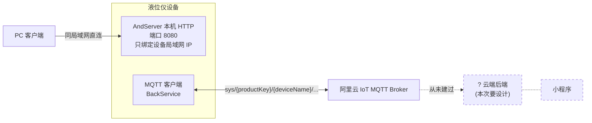
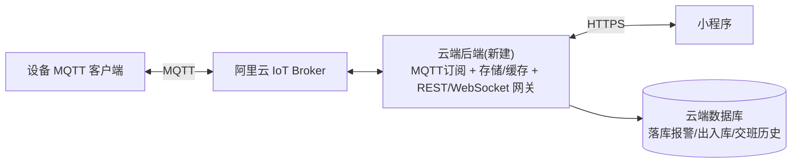

# 小程序端与 PC 端集成设计

> 适用范围：基于 `com.sansen.yeweiyi`（安卓液位仪）现有代码，为新建的小程序端、PC 端提炼接口与数据契约
> 撰写日期：2026-08-07
> 状态：设计草案，**云端后端部分尚未开始开发**，本文档是该后端与小程序的设计输入

---

## 一、现状架构（已读代码核实）

设备目前有两条独立的对外通道，**没有第三条能被小程序直接使用的通道**：

- **本机 HTTP（LAN）**：设备自己起 AndServer，只绑定设备的局域网 IP，端口 8080。PC 端如果和设备同局域网，可以直连——这是本文档里**唯一不需要新开发就能用**的通道。
- **MQTT（阿里云 IoT）**：设备双向对接阿里云 IoT——上报数据、也订阅了 9 个 `thing/service/*` 主题接受云端下发的分页查询请求并应答。但**云端这边订阅并消费这条数据流的后端服务从未建过**（`ApiConfig.BASE_URL` 全项目零调用，`OkgoNet` 里网络请求打的还是 `www.baidu.com` 占位符）——这是本文档要设计的主体部分。

小程序只能走云端：微信小程序请求必须命中白名单里的 HTTPS 域名，够不着设备的局域网 IP，所以小程序必须经由一个新建的云端后端中转。

---

## 二、核心数据模型

以下字段直接从 `app/src/main/java/com/sansen/yeweiyi/db/*.java`（xUtils `@Column`/`@Id` 注解）读取，供云端后端设计数据库表结构、小程序设计前端展示字段时对照。

### Alarm（报警记录）
| 字段 | 类型 | 说明 |
|---|---|---|
| id | int, 自增主键 | |
| time | String | 报警时间 |
| info | String | 报警信息文本 |
| guanHao | String（列名 `guanhao`） | 罐号 |
| jieZhi | String（列名 `jiezhi`） | 介质（源码 javadoc 误标为"罐号"，以列名/实际用途为准） |

### OilInOut（出入库/卸油记录）
| 字段 | 类型 | 说明 |
|---|---|---|
| id | int, 主键 | |
| oilId | int | 关联油罐 id |
| jieZhi | String | 介质 |
| time | String | 记录时间 |
| beginHeigth / endHeigth | double | 开始/结束液位高度 |
| beginVolum / endVolum | double | 开始/结束体积 |
| beginWeight / endWeight | double | 开始/结束重量 |

### CommitWork（交班记录）
| 字段 | 类型 | 说明 |
|---|---|---|
| id | int, 主键 | |
| workId | int（列名 `workid`） | 交班班次/工号 |
| time | String | 交班开始时间 |
| endTime | String（列名 `endtime`） | 交班结束时间 |
| info | String（列名 `oilinfogson`） | **注意**：这是一段序列化后的 JSON 字符串（交班时的油罐信息快照），不是结构化字段，云端落库/透出给小程序时需要决定是原样透传字符串，还是解析后结构化存储 |

### OilCanSet（油罐配置，供"实时监控"展示用的元数据）
| 字段 | 类型 | 说明 |
|---|---|---|
| pk_oilCanId | int, 主键 | 罐号 1–9 |
| height / maxVolume | int | 油罐物理高度 / 最大容积 |
| oilType / oilColor | int | 油品类型 / 颜色枚举 |
| heightOilAlarm / hheightOilAlarm / lowOilAlarm / llowOilAlarm | int | 高/高高/低/低低油位报警阈值 |
| highTempAlarm / lowTempAlarm | int | 高/低温报警阈值 |
| gunType | int | 0=卧罐 1=立罐 |
| enable | int，非空默认0 | 是否启用 |

### 实时快照（`BaseOilCan`，非 DB 实体，`/baseOilcan` 与 MQTT `requestOilcan` 共用的内存快照结构）
`id, oilType, level（液位）, volume（体积）, weight（重量）, temple（温度）, oilRadio（油占比）, waterRadio（水占比）, connet（连接状态）, stateInfo（状态信息）`

---

## 三、PC 端设计（直连局域网，无需新建后端）

### 3.1 现有可直接使用的接口

| 功能 | 方法 | 路径 | 关键参数 | 返回 |
|---|---|---|---|---|
| 实时油罐数据监控 | POST | `/baseOilcan` | 无 | `{"pressure":0,"data":[BaseOilCan,...]}` |
| 报警查询 | GET | `/alarm` | `beginTime,endTime,order,limit,offset` | `PageInfo` 包 `List<Alarm>` |
| 出入库/卸油记录 | GET | `/oilDischarge` | `beginTime,endTime,order,id(罐号,可选),limit,offset` | `PageInfo` 包 `List<OilInOut>` |
| 登录 | POST | `/login` | `username,password` | 纯文本 `"200"`/`"400"` |

`PageInfo` 统一结构：`{total, page, current, limit, rows, start, type, offset}`。

### 3.2 需求缺口：交班记录没有 HTTP 接口

`CommitWork` 目前只能通过 MQTT 的 `requestShift` 拿到，设备本机 HTTP 服务里没有对应路由。PC 端如果要看交班记录，需要在 Android 端**新增一个 HTTP handler**（例如 `/commitWork`，照抄 `OilDischarge.java` 的分页/时间范围过滤模式即可，数据源是 `CommitWork` 表）。这是本设计文档识别出的、需要回到这个仓库里实际开发的一小块工作，不是纯文档产出。

### 3.3 需要在设计里明确标注的风险：当前 LAN 接口零鉴权

`/login` 只是查一下本地 `User` 表返回字符串，不发 token、不设 session；其余接口（`/alarm`、`/oilDischarge`、`/baseOilcan`、`/upload`）**完全不做任何鉴权检查**——只要能连到设备所在局域网、知道端口，谁都能直接调。这是现状，不是本文档新引入的问题，但如果 PC 端客户端要作为正式对客产品交付，建议在设计里加一条：至少给这些接口加请求头 token 校验（可以复用 `/login` 的用户表，登录后签发一个短期 token，其余接口校验该 token），而不是原样继续零鉴权状态。这是**待产品/安全侧确认的决策项**，本文档不擅自替你们做这个决定。

---

## 四、小程序端设计（需要新建云端后端）

### 4.1 建议架构

云端后端职责三件事：
1. **订阅** 设备发布的 `thing/event/*` 主题，把上报的数据（报警、在线状态）落库/缓存。
2. **主动请求**：对于历史查询类数据（报警/出入库/交班），云端后端向设备发布 `thing/service/*` 请求，收到 `thing/event/property/post/*` 应答后落库，再由 REST 接口读库返回给小程序（不建议让小程序的每次请求都直接触发一次 MQTT 往返——设备可能离线，MQTT 请求-应答有延迟，落库后走标准数据库查询更稳定）。
3. **向小程序暴露 HTTPS REST/WebSocket 接口**，小程序不直接碰 MQTT。

### 4.2 各功能到 MQTT 契约的映射（供云端后端开发对照）

**Topic 命名**：`sys/{productKey}/{deviceName}/thing/...`，`productKey` 是设备产品级别的常量（构建时注入），`deviceName` 是每台设备的唯一标识（设备密钥或用户配置的地址）。

| 功能 | 后端 → 设备（service，请求） | 请求体 | 设备 → 后端（event/property，应答或主动上报） | 应答/上报体 |
|---|---|---|---|---|
| 实时油罐数据监控 | `thing/service/requestOilcan` | 空/任意 | `thing/event/property/post/requestOilcan` | `List<BaseOilCan 等价快照>`（JSON 数组，非分页） |
| 报警查询 | `thing/service/requestAlarm` | `{sort,beginTime,endTime,limit,offset}`（`RequestRecord`） | `thing/event/property/post/requestAlarm` | `List<Alarm>` |
| 报警实时推送 | 无需请求，设备主动上报 | — | `thing/event/msg/post` | `{"msg": "<报警文本>"}` |
| 出入库/卸油记录 | `thing/service/requestUnloadOil` | `RequestRecord` | `thing/event/property/post/requestUnloadOil` | `List<OilInOut>` |
| 交班记录 | `thing/service/requestShift` | `RequestRecord` | `thing/event/property/post/requestShift` | `List<CommitWork>` |
| 设备在线状态 | — | — | `thing/event/isOline/post`（连接时上报，且是 MQTT Will，断线自动触发） | `{"isOline": true/false}` |

`RequestRecord` 结构：`{sort: boolean, beginTime: String, endTime: String, limit: int, offset: int}`（注意 `sort` 是布尔值不是字符串，语义需要和现有 Android 端 `order` 参数的 `"asc"/其他`两态对齐，建议云端后端统一成布尔值，PC 端保留字符串，避免两套客户端语义不一致）。

### 4.3 实时监控的语义要注意：这是"请求-应答"，不是持续推流

读代码确认：设备收到一次 `requestOilcan` 请求后，在接下来最多 1 秒内的轮询里应答一次快照，然后内部标志位复位——**不会持续推送**，每次都要重新请求。云端后端如果要给小程序做"实时"监控，需要自己维护一个轮询节奏（例如每 3–5 秒向设备发一次 `requestOilcan`，缓存最新一次应答），再通过 WebSocket 或小程序端轮询 REST 接口的方式把缓存数据推给小程序，而不是天真地假设设备会自己不停地推数据上来。

### 4.4 建议的小程序 → 云端 REST API 草案（云端后端待建，此处是设计建议，非既成事实）

| 功能 | 方法 | 建议路径 | 说明 |
|---|---|---|---|
| 实时油罐数据 | GET | `/api/oilcan/latest` | 返回云端缓存的最新快照，不直接触发 MQTT 往返 |
| 报警查询 | GET | `/api/alarms?beginTime=&endTime=&limit=&offset=` | 读云端落库数据 |
| 报警实时推送 | WebSocket | `/ws/alarms` | 云端收到设备 `msg` 主题上报后，推送给已连接的小程序端 |
| 出入库记录 | GET | `/api/oil-in-out?beginTime=&endTime=&oilId=&limit=&offset=` | |
| 交班记录 | GET | `/api/shifts?beginTime=&endTime=&limit=&offset=` | `info` 字段是否解析成结构化 JSON 返回，需产品侧确认（见二、CommitWork 表注释） |
| 登录鉴权 | POST | `/api/login` | 建议用正式 token（JWT 或类似），**不要**照搬设备本机 `/login` 那种无 token 方案 |

---

## 五、待决策/风险清单（本文档不擅自替你们决定）

1. **云端后端从零建**：整个"订阅 MQTT → 落库 → 暴露 REST/WebSocket"这层服务需要新开发（新仓库/新服务），本文档只给了契约设计，不含实现。
2. **MQTT 鉴权是硬编码的 `admin`/`password`**（`BackService.java`，与 `ApiConfig` 无关），broker 地址也是运行时从本地配置读取而非写死的阿里云端点常量。新建云端后端接入前，需要先确认这套凭据和 broker 地址在生产环境的真实值，硬编码弱口令这件事本身也建议一并提给安全侧评估。
3. **交班记录在 LAN 侧没有 HTTP 接口**——PC 端要看交班记录，需要回到这个 Android 仓库新增一个 handler（见 3.2）。
4. **PC 端 LAN 接口零鉴权**——是否要加最基本的 token 校验，需要产品/安全侧拍板（见 3.3）。
5. **`CommitWork.info` 是拼好的 JSON 字符串而非结构化字段**——云端落库时是原样存字符串，还是解析后拆表，会影响后续小程序展示的实现复杂度，建议现在就定，不要留到开发中期发现。
6. **`requestTankTable`/`requestTankSet`/`requestProbeSet` 三个服务主题设备订阅了但没处理逻辑**——如果小程序未来需要远程配置罐体/探针（本次范围里没提，但供后续参考），这部分设备端逻辑也是空的，需要一并开发，不是"已经支持只是没暴露"。
