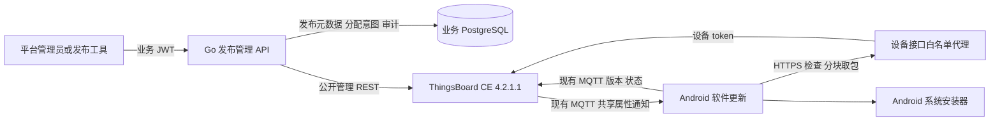
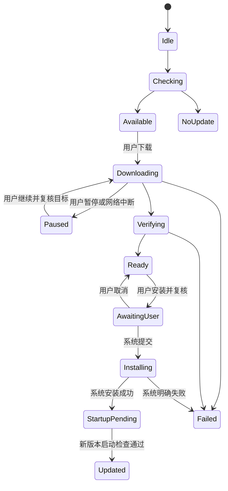

# ThingsBoard 应用内更新实施设计

设计日期：2026-11-26，实施更新：2026-11-28。代码基线：main `ab1f6b91`。范围：Android APK、cloud、TB CE 与部署。本文描述目标设计；已实现部分以 [实施状态](../../../../cloud/docs/app-update-contract.md) 和任务清单为准。

用户已确认 TB 选型和高级设置入口。执行清单见 [tasks.md](tasks.md)，行为契约见 [设备更新](specs/update/app-update/spec.md) 与 [发布管理](specs/update/app-release-management/spec.md)。

## 1. 当前代码与缺口

| 现状 | 当前依据 | 对实施的影响 |
|---|---|---|
| 高级设置已有云平台、日志和返回入口 | `fragment/SetSeniorFragment.java:39`、`res/layout/fragment_senior_set.xml` | 底栏新增软件更新按钮，避免直接增加第三排大图标导致裁切 |
| 页面通过 hide/show 切换 | `activity/MainNavigator.java:41` | 更新页面缓存单实例；隐藏时解绑观察者，任务不随 Fragment 销毁 |
| 设备已使用一机一密，私有 CA 有既定加载规则 | `manager/ThingsBoardCredentialStore.java:40`、`manager/ThingsBoardCaStore.java:31` | HTTP 复用凭据来源，单独装配 HTTPS 信任和标准主机名校验 |
| MQTT 已订阅属性推送和请求应答 | `manager/ThingsBoardMqttConnection.java:153` | 复用一个 MQTT 连接；回调只分发事件，不执行下载、文件校验或安装 |
| 主动查询只请求 reportIntervalSec | `manager/ThingsBoardManager.java:630` | OTA 字段独立解析；保留现有上报周期逻辑和请求匹配 |
| 实施基线 versionCode=5、versionName=1.0.5-Q | `app/build.gradle:68` | 每个可发布 APK 必须递增 code，不能继续只变更字母后缀；本轮不制作发布包 |
| 正式签名缺失时仍能产出 unsigned release | `app/build.gradle:33`、`signingConfigs.release` | 发布检查必须拒绝 unsigned/debug 包，不以 assembleRelease 成功作为可发布依据 |
| 旧更新流程没有业务调用者，旧安装用 file URI | `logic/LoginHelper.java:29`、`utils/ApkUtils.java:57` | 不接通旧流程；新增完整更新模块，不顺手清理无关死代码 |
| 没有安装权限声明、安装结果与替换后恢复接收器 | `app/src/main/AndroidManifest.xml` | 补 PackageInstaller 流程与 MY_PACKAGE_REPLACED 恢复；原 BootBroadcastReceiver 的业务体为空 |
| 本地库 schema 当前为 8 | `db/help/DaoHelp.java:createDB` | OTA 状态独立文件保存，不为 OTA 改动业务库；旧版本跨 schema 升级另验 |
| Go TB Client 的设备模型只覆盖部分字段 | `cloud/internal/tbclient/devices.go:Device` | 分配包时不能将这个精简模型直接 POST 回 TB，否则可能丢失其他设备设置 |
| Go TB Client 的通用请求按 JSON 编码，并整包读取响应 | `cloud/internal/tbclient/client.go:do/roundTrip` | 上传 APK 必须增加独立、有界、可重放的 multipart 实现 |
| TB HTTP 端口仅绑环回，Nginx 默认只转 Go API | `cloud/docker-compose.thingsboard.yml:33`、`cloud/deploy/nginx-api.conf.example` | 增加精确的设备 GET 代理，继续关闭管理控制台公网访问 |
| Nginx 示例最大请求体 1 MiB；本地 debug APK 约 62 MiB | 同上；`app/build/outputs/apk/debug/` 本地产物 | 分别调整导入 API、Nginx、TB 请求体及 multipart 限额；正式包大小发布时重测 |
| CE 云端固件分发有历史验收 | `cloud/docs/thingsboard-ce-baseline.md:181` | 只证明当时 FIRMWARE 云端能力；SOFTWARE、分块和真机 APK 安装需重新验证 |

本轮未访问生产设备或更改生产 TB；旧验收记录不能当作本功能已经通过。

## 2. 首版范围与总体架构

首版交付：检查更新、版本说明、完整 APK 分块下载、暂停/继续/取消、完整性和兼容性校验、系统安装确认、安装后启动确认、单设备发布与撤销、平台管理员审计、无互联网环境运行。

后续迭代：网页包管理、批次/客户发布调度、静默安装、差分更新、自动后台下载、定时安装、整机系统 OTA、自动回滚。首版不依赖这些能力即可独立验收。

职责边界：TB 存二进制、计算摘要、分配 SOFTWARE 包并执行设备 token 下载鉴权；Go 管权限、发布说明、分配意图与审计；Android 决定何时下载和安装并确认真实结果。设备不登录 Go 业务账号，不持有 TB 租户管理员密码，也不从 Go 获取公开 APK 链接。

## 3. TB 通道与检查更新

### 3.1 选择 SOFTWARE

APK 使用 TB `SOFTWARE` 包、设备 `softwareId`、标准 `sw_*` 字段，固件 `fw_*` 保留给未来系统/硬件固件。旧协议 §5.3 增补软件更新小节，不重定义固件字段。

TB 4.2.1.1 源码提供设备 GET 属性和 `/software` 下载接口，也提供 `size`、`chunk` 参数；这属于源码核对，目标部署上的行为由 P0 集成测试确认。[上游固定版本源码](https://github.com/thingsboard/thingsboard/blob/v4.2.1.1/common/transport/http/src/main/java/org/thingsboard/server/transport/http/DeviceApiController.java)

### 3.2 原生接口

| 用途 | TB 原生接口 | 首版调用方式 |
|---|---|---|
| 检查/下载前/安装前复核 | `GET /api/v1/{token}/attributes?sharedKeys=...` | HTTPS，限定更新字段，读取完整新快照 |
| 下载 | `GET /api/v1/{token}/software?title=...&version=...&size=...&chunk=...` | HTTPS，固定分块大小、单任务、串行块 |
| 通知 | `v1/devices/me/attributes` | 复用 MQTT，仅触发候选失效/重新检查 |
| 上报 | `v1/devices/me/telemetry` 与客户端属性通道 | 复用 MQTT；关键结果使用 OTA 独立持久化发件状态 |

手动点击“检查更新”以 HTTPS 新响应为准，MQTT 断线不直接判定无法检查。HTTP 失败不得显示“无更新”。已有 MQTT 属性推送可能只有部分字段，不能直接拼接成可安装候选；收到涉及更新的变化或删除通知后重新读取完整快照。

下载前、断点继续前、点击安装时均重新检查，发现目标变化或撤销则终止相应旧任务。检查结果只有在设备身份、连接配置代次及请求代次仍相同时才能更新 UI。

### 3.3 HTTPS 地址与凭据

- 增加独立 `sansen.thingsboardHttpBaseUrl` 构建配置及 `ApiConfig.THINGSBOARD_HTTP_BASE_URL`；按既有云平台设置方式提供持久化覆盖，私有部署填写内网 HTTPS 地址。
- 地址指向所配置 TB 的白名单代理入口；不能根据 MQTT 的 8883 端口猜 HTTP 地址，也不能误用历史 `BASE_URL` 的旧注册服务。
- 云平台设置增加“设备 HTTPS 地址”，显示实际生效值，保存前要求确认，保存后增加连接配置代次并取消旧更新任务。token 只发给这个明确配置的 HTTPS origin，不从 manifest 接收下载 host。
- 复用 ThingsBoardCredentialStore 的运行时 token；状态文件、日志、异常、导出文件均不保存完整 token URL。token 轮换或设备身份变更会取消旧请求并隔离旧结果。
- HTTPS 默认使用系统信任库与标准 hostname verifier；私有部署显式配置 HTTPS CA，可选复用已有 TB CA 文件，但不自动认定 HTTPS 与 MQTT 使用同一证书。公网和私有证书都需实测，不复用 MQTT 的特殊 socket 工厂绕过 HTTP 主机名检查。
- 禁止自动跨 origin 重定向，不提供信任所有证书或明文回退选项。

## 4. 版本及发布说明契约

### 4.1 标准属性与版本规则

| 字段 | 约定 |
|---|---|
| `sw_title` | 固定软件标识 `com.sansen.yeweiyi` |
| `sw_version` | Android versionCode 的十进制字符串；与 APK 实际 code 严格相同 |
| `sw_size` | 完整 APK 字节数 |
| `sw_checksum_algorithm` | 首版只接受规范化后的 SHA256/SHA-256 |
| `sw_checksum` | 完整 APK 的 64 位十六进制摘要，比较时规范化大小写 |
| `current_sw_title/current_sw_version` | 设备当前已安装软件标识与 code；启动时据本机 APK 如实上报 |
| `sw_state/sw_error` | TB 原生 OTA 状态与简短错误，不加入自定义 PAUSED 等枚举 |

只在目标 code 大于本机时允许更新。同 code 不同字母名称不构成可发布更新；同 code 不同摘要属于发布冲突，禁止复用。旧逻辑需要回退时，以更高 code 重新发布修复包，并验证本地数据 schema 向前兼容；不把“TB 可分配旧包”等同于 Android 可无损降级。

### 4.2 扩展共享属性 appUpdateManifest

发布管理按设备写入一个 JSON 属性，首版建议契约如下，P0 由 Android/cloud 联合评审冻结。

| 字段 | 类型与用途 |
|---|---|
| `schemaVersion` | 整数，首版为 1，不识别则拒绝更新 |
| `enabled` | 布尔，显式 false 表示发布侧禁止开始/继续该目标 |
| `releaseId`、`tbPackageId` | 不透明发布 ID 与 TB 包 ID，用于关联与诊断 |
| `assignmentRevision` | 同设备分配修订号，单调递增，防止迟到结果应用到新分配 |
| `title`、`versionCode`、`versionName` | 与标准 title/code 关联；name 用于人读显示 |
| `packageName` | 必须为当前 applicationId |
| `sizeBytes`、`sha256` | 必须与同快照标准属性一致 |
| `minSdk`、`supportedAbis` | 发布 APK 解析结果的兼容性摘要 |
| `releaseNotes` | 语言代码到纯文本的映射；限制总大小，当前语言缺失回退英文，再回退中文 |
| `releasedAt` | 带时区的 RFC3339 显示时间，不用于版本排序或安全有效期判断 |

manifest 不是独立可信签名。信任来自正确 HTTPS/TB 凭据和 APK 签名；APK 内的包名、版本、SDK、ABI 与签名仍要校验。不得直接信任 manifest 自报的签名证书。

同一份候选须满足标准属性与 manifest 的 title/code/size/hash 一致。无分配显示“暂无可用更新”；同版本显示“当前已是所分配版本”；属性缺失或不一致显示“更新信息同步中，请重试”；目标更旧显示“没有更高版本可更新”。

不将一次属性 GET 视为 TB 多次写入的数据库事务。多字段一致性检查与分配前后复核共同限制竞态；一旦安装会话提交，无法承诺服务端撤销能终止安装。

## 5. Android 模块与交互

### 5.1 拟修改与新增位置

| 位置，均相对 android/ | 职责 |
|---|---|
| `app/src/main/java/.../logic/update/` | 纯 Kotlin：候选解析、版本/兼容策略、下载标识、状态机、恢复决策、错误码、结果报文 |
| `.../manager/AppUpdateManager.kt` | 应用级协调者，单任务、独立工作线程、观察 UI、身份和连接代次 |
| `.../manager/AppUpdateHttpClient.kt` | OkHttp HTTPS 属性查询与原生分块下载；连接/读取超时、取消、有限重试 |
| `.../manager/AppUpdateFileStore.kt` | filesDir/update 下私有文件、原子状态、下载 checkpoint；复用 AtomicJsonFile 的写盘模式 |
| `.../manager/AppUpdateInstaller.kt` | PackageInstaller 会话、权限、结果处理；系统 API 与纯逻辑隔离 |
| `.../manager/AppUpdateReporter.kt` | MQTT 状态回传、版本上报、关键终态持久化及确认 |
| `.../fragment/AppUpdateFragment.kt` | 页面、确认框、进度和结果，缓存单实例 |
| `.../receiver/AppUpdateInstallReceiver.kt`、`AppReplacedReceiver.kt` | 安装回调、替换后恢复；导出和 PendingIntent 策略按系统来源分别设计 |
| `.../fragment/SetSeniorFragment.java`、`ThingsBoardSetFragment.java` | 软件更新入口、HTTPS 地址配置 |
| `.../activity/MainActivity.java`、`application/MyApplication.java` | 页面缓存和轻量初始化/启动检查接入；不在主线程读大文件 |
| `.../manager/ThingsBoardManager.java` | OTA 监听和发布入口，保留现有 RPC、遥测和报警时序 |
| `app/src/main/AndroidManifest.xml`、`res/xml/`（若需要） | REQUEST_INSTALL_PACKAGES、结果接收配置；会话写入不依赖公开 file URI |
| `app/build.gradle`、`local.properties.template`、`config/ApiConfig.java` | HTTP 地址配置、每包递增 code、构建产物元数据 |
| `tools/` | 生成/检查待发布包描述：签名、code、包名、ABI、SDK、摘要、大小与版本说明 |

省略的包前缀为 `com/sansen/yeweiyi`。实现不要求每个职责各建一个类，可按内聚性合并；公开接口保持可注入，便于验证故障和重启恢复。

### 5.2 页面

高级设置底栏加入“软件更新”，新页面显示当前版本、目标版本、更新说明、大小、上次检查时间与当前状态。布局采用可滚动内容区与固定操作栏，复用现有尺寸体系，验证终端实际横屏分辨率。

| 页面状态 | 操作与提示 |
|---|---|
| 未配置设备或 HTTPS | 明确缺少哪项，可前往云平台设置 |
| 待检查/检查中 | 检查更新；检查期间防重复点击 |
| 无分配/同版/旧版 | 使用 §4 的不同结果文案 |
| 可更新 | 显示目标 name/code、说明、包大小；下载按钮 |
| 下载中 | 百分比、已下载/总字节、速度；暂停、取消；可离开页面 |
| 已暂停/异常中断 | 继续下载、取消；不自动开始下载 |
| 校验中 | 显示状态，禁止安装；校验也在工作线程 |
| 就绪 | 安装、删除下载包；点击安装再次查询目标与校验本地文件 |
| 权限/系统确认 | 引导设置后返回重新检查；用户拒绝可再次手动安装 |
| 完成/失败 | 显示实际版本或可理解原因；详情进入日志 |

页面返回不会取消下载；手动暂停/取消才终止网络请求。页面不持有安装器或网络线程；隐藏/销毁时解除观察者和时间回调。连续进入不重复创建 Fragment 或下载任务。

新增用户文案进入七种可选语言资源；发布说明按用户语言回退。按本地规范登记腾讯文档文案表，属于后续实现任务，不在本计划轮写外部文档。

### 5.3 状态与 TB 映射

本地另有 Invalidated/Cancelled，表示目标变更或用户删除任务。TB 只上报它支持的状态：下载开始 DOWNLOADING，收齐 DOWNLOADED，验证通过 VERIFIED，系统会话提交前 UPDATING，新版本启动检查通过 UPDATED，确定失败 FAILED。暂停、等待权限、确认中等细节放扩展结果，不伪造 TB 枚举。

## 6. 下载、校验与故障恢复

### 6.1 分块策略

- 建议首版块大小 1 MiB、并发 1、单块最多 3 次带退避重试；连接 10 秒、读取 60 秒。均为初始工程默认值，P0 用真实链路测后冻结，不宣称性能 SLA。
- 使用 TB `size`+`chunk`，不假设 HTTP Range/206 可用；每块核对状态码与期望字节数。最后一块的期望长度由完整 size 精确计算，不通过“收到空块”猜下载结束。
- 状态以 endpoint/设备身份/凭据代次/releaseId/revision/title/code/size/hash/块大小绑定。文件名由受控 ID 生成，不使用 URL 或服务端文件名拼磁盘路径。
- `.part` 放应用 filesDir/update；块写完并 fsync 后再原子记录 committedBytes。重启时截掉未提交尾部；磁盘文件短于 checkpoint 时退到可确认的完整块或重新下载。
- 继续前重新查询目标，完成后重新计算完整 SHA-256；不把持久化的增量 hash 当作可信验收。空间按剩余下载量加安装暂存量和安全余量检查，至少预留目标完整包一份的安装空间。
- UI 进度节流，不逐 buffer 刷新；大文件只流式处理。任务独立线程运行，不能占 MQTT 回调、RPC 执行、报警队列和探头采集线程。
- 401/403 停止并提示凭据/权限；400/404 触发目标重查；429/5xx/超时有限重试后保留 checkpoint 等待用户继续。HTML 错页、长度不符、超大响应均不能写成成功包。
- 暂停保留分块，取消清理该任务私有文件；正在校验或安装器仍需读取的文件不能提前删除。最多保留一个有效目标与有界故障证据，清理失败写日志。

### 6.2 安装前校验

依次检查实际长度、完整 SHA-256、APK 可解析、packageName、真实 versionCode 与 manifest/TB code 一致且更高、versionName 一致、minSdk 与设备系统匹配、native ABI 兼容、候选签名证书与当前安装包及正式签名策略兼容。首版采用固定同签名，不引入签名轮换。

PackageManager 的签名预检不能替代系统最终安装验证；安装器必须接受并验证签名。不能用同源 SHA-256 代替可信签名，也不能仅依赖 manifest 里的 signer 声明。发布工具使用 Android SDK 的 apksigner/aapt 类工具验证真实产物并生成描述。

当前终端若装 debug 或历史不同签名包，不能直接无损覆盖到正式签名，须列出设备并单独制定一次性迁移和数据备份步骤。严禁把卸载重装作为应用内更新的自动兜底。

### 6.3 持久化

状态文件包含 schema、当前身份和配置标识、候选快照、下载 checkpoint、安装 sessionId、attemptId、前后 versionCode、结果发件状态。token、管理员凭据不落入更新状态文件。

临时文件+fsync+rename，并核对写入成功；写失败不能提交安装。损坏状态隔离，仍需核对当前已安装版本和系统会话，不能按空状态重新安装。OTA 关键结果单独保存，避免进入现有报警队列后挤占或丢弃业务事件。

## 7. 安装、启动与安全边界

1. 用户点击安装，HTTPS 复核分配、revision 和摘要，再次校验本地文件；网络不可用时保留包并提示稍后确认，首版不允许离线绕过撤销检查。
2. API 26+ 检查未知来源安装授权；声明 REQUEST_INSTALL_PACKAGES，按用户操作进入授权设置。返回后再复核，不自动安装。
3. 使用 API 21 已提供的 PackageInstaller Session 流式写 APK，保存 sessionId/attemptId。对 STATUS_PENDING_USER_ACTION 展示系统确认流程；不依赖 API 31+ 的 setRequireUserAction，也不为本功能升级 targetSdk。
4. 提交前持久化安装意图与待上报 UPDATING，完成本地数据库/事件队列必要写入和日志刷新；只需保证本地耐久，不要求断网时等待云端 ACK。写盘失败时保留旧应用运行。
5. 安装提交会结束旧进程。系统结果接收器处理明确成功、失败和用户取消；若回调丢失，依据本机 code、session 信息和持久化意图恢复判断，不能仅因进程结束就判失败。
6. 结合 MY_PACKAGE_REPLACED、应用作为 HOME 的行为与终端厂家恢复机制，验证新进程能重新进入主界面。广播唤起前台受系统限制，不能把接收广播视为一定能拉起 Activity。
7. 新应用加载业务库和配置、完成主界面与采集调度初始化后，再确认本机 code 等于本次目标并置 UPDATED。启动检查不要求探头一定有正常读数或网络已恢复，但不能只在 Application.onCreate 的开头就报成功。
8. 新版本一直未启动时，服务端显示“安装后启动尚未确认/报告过期”，保留 UPDATING 的真实证据，不擅自写“升级成功”或“已回滚”。

安装回调 Intent/PendingIntent 必须适配终端 Android 13：检查系统填充 extras 的可变性要求、session 和 attempt 绑定、显式接收目标及 exported 配置；不接受外部伪造“安装成功”。MY_PACKAGE_REPLACED 仅接受本包系统替换事件。具体 flag 方案在 P0 小型真机原型验证后冻结。[Android 安装 API](https://developer.android.com/reference/android/content/pm/PackageInstaller)

复用当前 MainActivity 的 HOME 配置时须测多实例问题；若安装返回触发重复初始化，单独用最小变更处理 launchMode/onNewIntent，并验证导航、采集和生命周期，不能把既有问题默认为已经修复。

下载与校验期间照常采集和报警。安装明确提示监测短暂中断，安排现场维护窗口；不为更新调用泵、阀门、报警清除或远程重启命令。安装重启对 IO2、声光输出的实际影响纳入真机验收，沿用既有逻辑，不许诺无间断监测。

不承诺自动回滚。没有独立更新代理、系统权限和数据库回退设计时，新应用无法可靠回滚自己；失败处理是旧版仍在则保留运行、安装后异常则通过更高 code 修复包或现场恢复流程处理。[Android 签名约束](https://developer.android.com/studio/publish/app-signing)

## 8. 状态上报与服务端展示

增加客户端能力属性 `appUpdateCapability=1`、`appVersionCode`、`appVersionName`。能力缺失不禁止设备读取已有业务配置，但服务端默认不向其分配本功能包；首次启用使用现场/既有工具安装的引导版本。

新增单个 JSON 遥测 `appUpdateReport`，包含 schemaVersion、releaseId/revision、attemptId、reportSeq、targetVersionCode、currentVersionCode/name、localState、errorCode、downloadedBytes/totalBytes、时间。reportSeq 按设备身份耐久递增，进程重启不归零。每次报告为完整快照，服务端不能把不同时间的多个 latest key 拼成一次更新结果。

标准 sw_state 与扩展 JSON 在同一 telemetry 信封发送。进度最多每 5 秒或状态切换时发送，暂停/就绪/失败/成功持久化；MQTT 不通时保存本地最新完整报告，恢复后发送。收到 QoS1 delivery 确认前不删除待发终态；确认回调须匹配 reportSeq，不能清除更晚的新状态。publish 返回 true 不代表确认，QoS1 确认也只代表 TB 传输接收，不是业务落库回执。

恢复后先报告当前真实状态，不顺序重放过时 DOWNLOADING 去覆盖已经 UPDATED 的结果。服务端按本次 desired revision 与 reportSeq 关联；旧分配结果仅作诊断，不能让新目标显示成功。current_sw_version 始终反映已安装软件，管理员撤销或改配不改变该事实。

状态查询同时返回：业务库期望分配、TB 实际包/属性、设备完整报告与 reportedAt、连接/报告新鲜度。TB 暂时不可用返回明确错误；无报告、旧版无能力、报告过期、安装未确认分别显示，不当作 0% 或成功。上报与查询不要求将下载进度复制到业务数据库。

## 9. cloud 发布管理

### 9.1 拟实现模块和数据

| 位置，相对 cloud/ | 职责 |
|---|---|
| `internal/tbclient/ota.go` | SOFTWARE 包查询/创建/上传/读回校验、设备原始对象读改写、共享说明属性、状态读取 |
| `internal/tbclient/client.go` | 有界 multipart/文件流请求，独立上传 timeout，可重开文件的一次 401 重试；不修改现有 JSON 调用语义 |
| `internal/ota/` | 发布导入、候选校验、分配意图、后台对账和部分成功恢复 |
| `internal/api/ota.go`、`router.go` | 业务 JWT、平台管理员权限、幂等与 API 错误码 |
| `db/migrations/`、`db/queries/ota.sql` | 发布及分配表、SQL 守卫、中文注释；迁移编号实施时取当前下一号 |
| `internal/store/db/` | 仅 sqlc generate 产生 |
| `internal/config/config.go`、`cmd/server/main.go` | OTA 开关、大小/超时与恢复 worker 装配 |
| `internal/api/tenancy_test.go`、`db/queries/device_purges.sql` | 路由访问回归、设备删除残留与写入栅栏 |

建议两类业务表：

- `ota_releases`：releaseId、TB packageId/profileId、title/code/name/packageName、size/hash、SDK/ABI/说明、导入状态、创建人和时间。二进制仍只在 TB；成功发布元数据不可原地改成另一包。
- `ota_device_assignments`：deviceName 唯一、期望 releaseId 或撤销、revision、同步状态/步骤、requestId 和提交人、错误与重试时间、租约/处理代次。它记录操作意图，不镜像连续设备进度。审计历史使用现有 audit_log。

当前分配行不是历史幂等凭据。每次分配/撤销的 allowed 审计耐久保存 requestId、payloadHash、revision 和目标，增加对应操作范围的唯一索引与查询；后续 succeeded/failed 使用独立动作记录关联 revision。旧 requestId 重放返回原 revision 的结果或 superseded，不复原旧目标，也不能在当前行被覆盖后重新派发。

写分配须在 SQL 中复核当前平台角色、设备可操作性和删除栅栏；修改使用 expectedRevision，版本冲突返回 409。并发 worker 使用数据库租约与代次守卫，不把网络请求放在长事务或行锁中。每设备至多一个生效中的同步任务，新修改须待前次收敛或显式返回冲突。

新表同时纳入设备彻底删除、CountDeviceRemnants 和换客户处理：换客户时撤销旧分配意图，不向新客户延续未经复核的更新安排；删除清理分配并阻止 worker 写回。全局发布包不随单个设备删除。

### 9.2 最小管理接口草案

| 接口 | 行为 |
|---|---|
| `POST /api/ota/releases` | multipart APK + 发布描述 + requestId，导入 TB，成功时返回 ready；相同 requestId 与内容幂等，不同内容 409 |
| `GET /api/ota/releases`、`GET /api/ota/releases/:id` | 分页/详情，含 ready/importing/failed 及校验摘要 |
| `PUT /api/devices/:device/app-update` | `{releaseId,expectedRevision,requestId,reason}`，持久化意图和审计，202 只表示受理 |
| `DELETE /api/devices/:device/app-update` | JSON 请求体含 expectedRevision/requestId/reason，记录撤销意图；不承诺终止已提交安装 |
| `GET /api/devices/:device/app-update` | desired/observed/deviceReport/freshness/error，区分分配同步完成与设备安装完成 |

这些接口首版全部仅平台管理员；客户管理员、员工在解析请求体/查设备前按角色拒绝并记审计。设备级路由登记 deviceScopedRoutes 并验证当前账号状态；包全局路由登记豁免理由。首版通过命令行 HTTP 工具或集成测试调用，可后续提供复用相同 API 的发布工具与网页，避免本次扩展 admin/miniapp 范围。

错误码至少包括 ota_disabled、release_not_ready、release_conflict、request_id_reused、assignment_revision_conflict、assignment_sync_in_progress、ota_device_unsupported、device_purge_in_progress、tb_unavailable。未知设备对非平台管理员不泄漏存在性。上传超过限额在读完文件前拒绝。

### 9.3 包导入

先校验描述、大小上限与 requestId，流式落到有容量限制的暂存目录并计算摘要；元数据须来自 Android 发布工具实际解析的正式 APK，首版限制受信平台管理员导入。设备安装前再次独立验证，不能把服务端受信描述视为 APK 真实性证明。

导入记录保存 TB packageId 后上传文件；TB 回应/连接超时时，读回元数据与摘要判定是否已成功，不能盲目另建同 title/code 包。TB 摘要与本地摘要不一致则不可置 ready。上传接口的 401 重试通过重开同一暂存文件实现，不能重放已消费的一次性 reader。

暂存文件有单文件/总配额、并发上限、错误清理和启动清扫。成功后删除本地二进制暂存；TB 残留包在查明是否已引用后人工或受控清理，禁止失败时自动删掉可能已分配的包。

### 9.4 单设备分配与撤销

分配顺序：持久化 pending 意图和 allowed 审计 → 写 enabled=false 的过渡 manifest → 获取 TB 完整设备 JSON → 保留所有无关字段并带最新 version 修改 softwareId → 等标准 sw_* 符合目标 → 写匹配的 enabled=true manifest → 读回核对 → 分配成功审计。

只修改 softwareId 时必须使用原始 JSON/RawMessage 读改写，保留 firmwareId、profileId、credentials 相关引用、additionalInfo 与未知字段；遇 409 重新读取并有界重试，不使用精简 Device DTO 覆盖保存。

撤销顺序：先发布当前 revision 的 enabled=false → 清除单设备 softwareId → 检查实际 sw_* 与配置文件继承 → 标记同步结果。首版专用 device profile 不配置软件默认包，且服务启动/发操作前检查此约束；发现 profile 默认包则拒绝或显式提示，不能把“清除覆盖后继承默认包”当作撤销成功。

上述 DB 与 TB 不能原子提交。worker 保存步骤，超时保留 pending/reconciling，通过读回实际设备和 manifest 继续收敛；不返回已安装、不盲目恢复旧包。同步失败不影响液位业务服务启动，功能开关关闭时新操作拒绝，既有未知结果保留诊断。

allowed 审计与业务意图同事务；只有 TB 读回一致后写 succeeded，同步明确失败写 failed，拒绝写 denied。audit_log 仅使用其现有合法 outcome；token、上传体和管理员密码不进入审计。撤销不会中止已经提交给 Android 系统的安装会话，此边界须在管理响应与运维说明里表达。

## 10. 部署、大小限制与离线交付

| 项目 | 首版拟定值或处理 |
|---|---|
| APK 上限 | 128 MiB，服务端和设备统一拒绝超限；正式包产物验证后可调整 |
| 管理导入总请求 | Nginx 路由级约 132 MiB，其他业务接口保持原有上限；Go 使用 MaxBytesReader/流式 multipart，额外描述大小单独限制 |
| TB 上传请求 | HTTP_MAX_PAYLOAD_SIZE_LIMIT_CONFIGURATION 对 otaPackage 路径先匹配到足够上限，保留其他默认规则 |
| TB multipart | SPRING_SERVLET_MULTIPART_MAX_FILE_SIZE 与 MAX_REQUEST_SIZE 覆盖 128 MiB APK 和 multipart 开销 |
| 上传耗时 | 独立、可配置上传 timeout，验证 62 MiB 以上包；不沿用普通 TB Client 的 30 秒全请求限制 |
| 设备代理 | 仅 GET `/api/v1/{token}/attributes`、`/software` 到 TB 8081；不放开整个 /api/v1 或 TB 管理 API |
| 日志 | 设备 token 在路径内，现有只去 query 的日志格式不够；该 location 独立脱敏路径日志或关闭 access log，并验证 error log 与异常不泄漏 |
| 缓存 | token 路径 no-store，不经共享缓存；保留 title/version/size/chunk 查询参数 |
| 隔离 | TB 控制台 8081、数据库/Redis 仍仅环回；外部访问白名单代理，不能顺带开放管理接口 |
| 私有部署 | 独立内网 HTTPS 地址和 CA，通过离线包携带配置、更新包与发布工具，不依赖公网对象存储、CDN、GitHub 下载或在线许可证 |

上游 4.2.1.1 的配置同时包含请求体路由限额和 multipart 限额，必须一起验收，而非只改 Nginx。[固定版本配置](https://github.com/thingsboard/thingsboard/blob/v4.2.1.1/application/src/main/resources/thingsboard.yml)

新增 `/api/v1` 设备路由可能与 Go catch-all 冲突，部署检查验证正确 upstream、只允许 GET、错误 token 401、管理路径不可达。nginx -t 与 Compose 展开检查通过后，在测试部署用实际大包验证。

## 11. 分阶段实施和完成标准

| 阶段 | 工作 | 交付与退出标准 |
|---|---|---|
| P0 契约与原型 | SOFTWARE 实测、HTTP 分块/撤销/大包、真实安装会话/恢复原型、字段和入口评审 | 软件通道证据、受测硬件/系统/签名清单、冻结 fixture；高风险假设可复现 |
| P1 cloud 与部署 | 包导入、两类业务表、分配对账、API 权限审计、代理与限额 | 集成测试可对专用测试设备分配/撤销 62 MiB 以上包；失败重启能收敛 |
| P2 Android 检查与下载 | 纯逻辑先测、HTTP 配置、页面、分块和持久化、属性通知 | 真机能检查、暂停/继续、变更目标、断网/断电恢复且不影响采集 |
| P3 校验与安装闭环 | APK 校验、权限、Session、替换恢复、结果确认 | 引导版本到下一版本原地升级、数据保留、启动后才显示成功 |
| P4 联合验收与交付 | 故障矩阵、离线网络、真实采集报警、发布说明 | 验收记录、运维手册、签名备份与修复包预案、单设备试点通过 |

依赖顺序为 P0 → P1 → P2 → P3 → P4。P1 的云端开发与 P2 的纯逻辑可以在 fixture 冻结后分别推进；不要求多代理工作。规划估算约 10–15 个开发工作日，另留 2–3 个工作日真机与现场窗口；这是范围估算，不是交付承诺，P0 后按硬件安装能力修订。

首版引导包必须通过现有安装手段先装到测试终端；没有 OTA 客户端的旧 APK 无法靠本次功能自行获得更新。发布顺序为：测试 cloud/代理 → 引导 APK → 更高 code 验证包 → 单台现场试点 → 人工按设备扩大范围。默认不操作整个 profile、不向全量设备自动分配。

## 12. 验收矩阵

| 优先级 | 验收场景 | 必须观察到的结果 |
|---|---|---|
| 高 | 包篡改、截断、错误包名、同 code 换包、错误签名、错误 ABI/SDK | 安装前拒绝；旧应用和数据仍可用 |
| 高 | 下载/校验/写 checkpoint/安装会话各阶段掉电 | 不误报成功；可识别已提交会话或从可信 checkpoint 恢复 |
| 高 | token 轮换、换设备身份/HTTP 平台、跨 origin 跳转 | 停旧任务，无 token 泄漏，无旧状态污染新身份 |
| 高 | 分配/撤销/上传在 TB 已成功后网络超时，Go 重启 | 读回对账，无重复发布、无其他字段丢失，审计能说明未确认状态 |
| 高 | API 越权、账号停用、并发改配、设备删除/换客户 | SQL/鉴权/修订号约束生效，worker 不回写被删设备 |
| 高 | 安装成功但进程未启动、MQTT 不通、结果回调丢失 | 成功只在目标版本启动后确认，报告过期与失败区分，终态可补报 |
| 高 | 实际探头采集、报警、出入库、IO2/声光 | 下载时保持现有行为；安装窗口与重启输出影响可测且已记录 |
| 高 | 原地更新后配置、罐表、报警/库存/交班历史与凭据 | 不卸载、不清库、不丢记录；包含存在的旧 schema 跨版本升级样本 |
| 中 | 无分配、同版、旧版、属性半更新、未知 schema | 页面结果准确，不误称全平台最新，不开始错误下载 |
| 中 | 暂停继续、切页、重复点击、低空间、401/404/429/5xx | 单任务、提示可恢复、有限重试，不占 UI/MQTT/采集线程 |
| 中 | 62 MiB 以上 APK、大包上传超时及配额 | 各层限额一致、内存有界、上传暂存最终可清理 |
| 中 | 完全无互联网，仅设备与私有平台互通 | 检查、下载、安装和回报全流程可用 |
| 低 | 七种语言、横屏布局、页面反复打开 | 无裁切、无硬编码、无重复观察/Fragment/时间回调 |
| 待确认 | 各量产终端系统/厂家限制、HOME 拉起、历史签名分布 | P0 采集实际清单，决定支持范围和引导步骤 |

本协作仅执行 Android assembleDebug；按最新 main 约定，Android 单测的编写/运行交专门同事，安装验收使用正式同签名包。cloud 运行新模块/协议测试，再按影响范围扩大回归、build 和 vet；需要 TB 的测试必须记录运行与跳过项。迁移做 down/up，sqlc 生成后确认无手改，不把待执行检查标为通过。

## 13. 主要风险和实施评审

| 级别 | 风险 | 处理 |
|---|---|---|
| 高 | 更新后未自动回到采集界面 | P0 先做真实终端原型；需要厂家守护/设备管理时先接通再交付 |
| 高 | DB 与 TB 非原子、撤销与安装竞态 | 持久化意图、修订号、过渡禁用、读回对账；明确安装提交后的撤销边界 |
| 高 | 正式/历史签名或数据库 schema 不兼容 | 引导前盘点；同签名覆盖和真实数据升级测试；禁止卸载兜底 |
| 高 | token 随 URL 进入日志 | 代理专用脱敏、HTTP 异常清洗、导出测试与负面用例 |
| 中 | 大包多层限额或超时 | 路由级限额、multipart/timeout 一起调；先验证当前实际 APK 大小 |
| 中 | profile 默认包导致撤销后继续继承 | 首版禁用该默认配置并校验；仅按设备分配 |
| 待确认 | SOFTWARE 通道、完整 fixture 与终端恢复细节 | P0 Android/cloud 联合冻结，登记 protocol-v1-open-items；TB 选型不再重复确认 |

本计划不依赖现存未完成的物理 RPC、遥测 TTL 调整或其他 OpenSpec 重构；相关功能保持原有约束。
